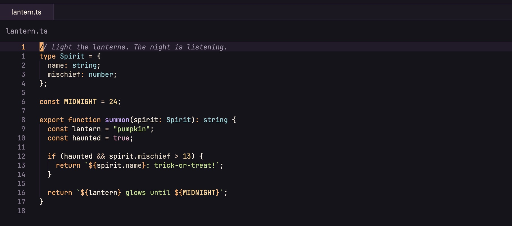
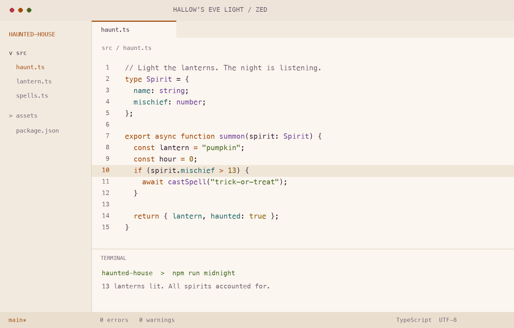

# Hallow's Eve

A Halloween-inspired theme family for [Zed](https://zed.dev), with pumpkin-orange keywords, witchy violet functions, and ghostly green strings.

- **Hallow's Eve** pairs warm charcoal surfaces with soft, luminous syntax colors.
- **Hallow's Eve Light** pairs warm ivory surfaces with deeper autumnal syntax colors.





These previews illustrate the theme palettes; they are not editor screenshots.

## Install

While the extension is awaiting catalog publication:

1. Clone this repository.
2. In Zed's command palette, run `zed: install dev extension` and select the cloned repository folder.
3. Run `theme selector: toggle` (`Cmd+K`, then `Cmd+T` on macOS) and select **Hallow's Eve** or **Hallow's Eve Light**.

You can also copy `themes/hallows-eve.json` to `~/.config/zed/themes/` on macOS or Linux, restart Zed, and select the theme.

Once accepted into Zed's extension catalog, search for **Hallow's Eve** in Extensions, install it, and select the theme.

To follow your system appearance, merge this setting into Zed's `settings.json`:

```json
{
  "theme": {
    "mode": "system",
    "dark": "Hallow's Eve",
    "light": "Hallow's Eve Light"
  }
}
```

## Palette

| Role | Dark | Light |
| --- | --- | --- |
| Editor background | `#17141C` | `#FBF6EF` |
| Text | `#F1E6D6` | `#3B293E` |
| Pumpkin orange | `#FFAA66` | `#A34A0C` |
| Witchy violet | `#C6A0F6` | `#74449C` |
| Ghostly green | `#B6D982` | `#476923` |
| Spectral teal | `#8DCED3` | `#286A70` |
| Comments | `#A194AA` | `#796779` |

Includes editor, panels, tabs, diagnostics, collaboration colors, and terminal ANSI colors. Main text, comments, and primary syntax colors exceed 4.5:1 contrast against the editor background.

## License

[MIT](LICENSE) © 2026 Fred Marques.

